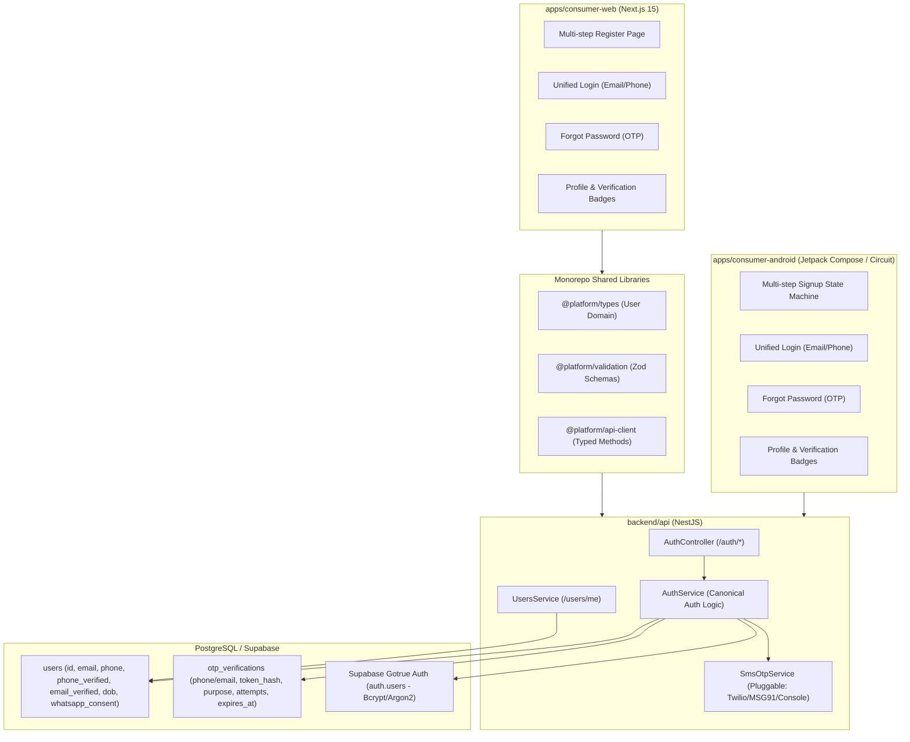

# Complete Authentication System — Deliverables & Architecture Report

## 1. Executive Summary & Audit Review

A comprehensive, production-grade authentication and identity system has been designed, audited, and implemented across the entire event booking platform. The consumer website (`apps/consumer-web`), consumer Android mobile application (`apps/consumer-android`), backend API (`backend/api`), database schema, and shared monorepo packages now operate on **one single canonical customer identity**.

A user registering on either platform can immediately sign in on the other using either their **registered email address** or **mobile number** with the exact same password, accessing the same tickets, profile data, and verification records.

---

## 2. Platform Architecture: Canonical Account & Shared Identity



### Architectural Guarantees:
1. **Single Source of Truth**: All authentication is validated against Supabase Auth credentials, with profile and identity attributes persisted in the PostgreSQL `users` table.
2. **Deterministic Identifier Resolution**: Sign-in with mobile numbers parses and normalizes the input to E.164 (`+91` standard for 10-digit numbers), locates the authoritative user account, and authenticates against Supabase Auth on the server. Clients never query raw user tables to resolve identities.
3. **Pluggable OTP Engine**: `SmsOtpService` implements rate-limiting (60-second cooldown), brute-force throttling (max 5 attempts), SHA-256 token hashing, and single-use 15-minute verification tokens. Providers (`TWILIO`, `MSG91`, `CONSOLE`) are dynamically selectable via environment variables without touching application code.
4. **Synchronized Verification**: Email and phone verification statuses are synchronized between Supabase Auth events and the `users` table (`phone_verified` and `email_verified`). Both platforms display dynamic badges and resend cooldowns.

---

## 3. Implementation Details

### Database & Migrations
- **File**: `database/migrations/0010_auth_canonical_identity.sql`
- **Schema**: `backend/api/src/database/schema/index.ts`
  - Added columns to `users`: `phone_verified` (BOOLEAN DEFAULT false), `email_verified` (BOOLEAN DEFAULT false), `dob` (VARCHAR(10)), `whatsapp_consent` (BOOLEAN DEFAULT false), `whatsapp_consent_updated_at` (TIMESTAMP), `terms_accepted_at` (TIMESTAMP), `terms_version` (VARCHAR(32)).
  - Created unique constraint index `users_phone_idx` on `users(phone)`.
  - Created table `otp_verifications` (`id`, `destination`, `destination_type`, `otp_hash`, `purpose`, `attempts`, `max_attempts`, `verified`, `token_hash`, `expires_at`, `created_at`, `updated_at`).

### Shared Packages
- **`packages/types`**:
  - Extended `User` domain model with `phoneVerified`, `emailVerified`, `dob`, `whatsappConsent`, `whatsappConsentUpdatedAt`, `termsAcceptedAt`, and `termsVersion`.
- **`packages/validation`**:
  - Added schemas: `phoneE164Schema`, `passwordSchema`, `sendOtpSchema`, `verifyOtpSchema`, `signupSchema`, `loginSchema`, `forgotPasswordRequestSchema`, `forgotPasswordVerifySchema`, `forgotPasswordResetSchema`, `changePhoneRequestSchema`, `changePhoneVerifySchema`, `changePasswordSchema`.
- **`packages/api-client`**:
  - Implemented typed API methods: `sendOtp()`, `verifyOtp()`, `signup()`, `loginWithCredentials()`, `requestForgotPasswordOtp()`, `verifyForgotPasswordOtp()`, `resetForgotPassword()`, `resendConfirmationEmail()`, `changePhoneRequest()`, `changePhoneVerify()`, `changeEmailRequest()`, `changePassword()`.
- **`packages/auth`**:
  - Updated `AuthProvider` to use `loginWithCredentials()` supporting both email and mobile identifiers.

### Backend (`backend/api`)
- **`SmsOtpService`** (`src/modules/auth/sms-otp.service.ts`):
  - Pluggable provider architecture (`Twilio`, `MSG91`, `Console` fallback for staging/dev).
  - Rate limiting (60-second cooldown per phone and IP).
  - Attempt limits (invalid attempts tracked up to 5, then invalidated).
  - Cryptographic token generation (SHA-256 hashed storage).
- **`AuthService`** (`src/modules/auth/auth.service.ts`):
  - `sendOtp()` & `verifyOtp()`: Validates inputs, manages verification tokens.
  - `signup()`: Enforces single-use verification token, creates user in Supabase Auth with unconfirmed email, inserts canonical record into `users` table, sends confirmation email.
  - `login()`: Normalizes identifier, resolves user by email or mobile, authenticates with Supabase, checks account status, returns session token and profile.
  - `requestForgotPasswordOtp()`, `verifyForgotPasswordOtp()`, `resetForgotPassword()`: Secure recovery flow returning single-use reset authorization token.
  - `resendConfirmationEmail()`: Secure email verification link dispatch with cooldown.
  - `changePhoneRequest()` & `changePhoneVerify()`: Authenticated phone modification protected by OTP.
  - `changePassword()`: Authenticated password updates via Supabase admin client.
- **`AuthController`** (`src/modules/auth/auth.controller.ts`):
  - Public endpoints: `POST /auth/otp/send`, `POST /auth/otp/verify`, `POST /auth/signup`, `POST /auth/login`, `POST /auth/forgot-password/request`, `POST /auth/forgot-password/verify`, `POST /auth/forgot-password/reset`, `POST /auth/resend-confirmation-email`.
  - Protected endpoints: `POST /auth/phone/change/request`, `POST /auth/phone/change/verify`, `POST /auth/password/change`.
- **`UsersService`** (`src/modules/users/users.service.ts`):
  - Updated profile mapper and updater to return and accept `dob` and `whatsappConsent`.

### Consumer Web (`apps/consumer-web`)
- **Login Screen** (`src/app/auth/login/page.tsx`):
  - Unified input supporting Email or Mobile number.
  - Show/hide password control.
  - Forgot password link and navigation.
- **Register Screen** (`src/app/auth/register/page.tsx`):
  - Multi-step signup:
    - Step 1: Mobile number with country code selection (`+91`, `+1`, `+44`, `+971`) + Email.
    - Step 2: 6-digit Mobile OTP entry with 60s cooldown timer, resend button, and phone editing.
    - Step 3: Full Name, Date of Birth, Password, Confirm Password, optional WhatsApp checkbox (default false), required Terms checkbox.
    - Step 4: Account confirmation screen informing the user of the verification link sent to their inbox.
- **Forgot Password Screen** (`src/app/auth/forgot-password/page.tsx`):
  - Step 1: Identifier input (Email or Mobile).
  - Step 2: 6-digit OTP verification.
  - Step 3: New password and confirm password submission.
  - Step 4: Success confirmation and redirect to Login.
- **Profile Screen** (`src/app/profile/page.tsx`):
  - Email verification badge ("Email verified" vs "Email not verified").
  - "Resend verification email" button with loading state, 60s cooldown, and feedback message.
  - Mobile verification badge and "Change Mobile Number" modal with OTP.
  - Date of Birth editing.
  - WhatsApp updates consent switch with instant persistence.
  - Change Password modal.

### Consumer Android (`apps/consumer-android`)
- **Domain & DTOs**:
  - `Models.kt`: `User` domain model with canonical identity fields.
  - `Dtos.kt`: `UserDto`, `UpdateUserRequestDto`, and complete Auth DTOs (`SendOtpRequestDto`, `SignupRequestDto`, etc.).
  - `Mappers.kt`: `UserDto.toDomain()` mapping all fields.
- **Networking & Repository**:
  - `AuthTokenProvider.kt`: Caches backend session tokens, bridges to Ktor `HttpClient` Bearer authentication, synchronizes with Supabase Auth.
  - `ApiServices.kt`: Created `AuthApiService` with full canonical endpoints.
  - `Repositories.kt` & `RepositoryImpls.kt`: Extended `AuthRepository` and `UserRepository` with full canonical authentication logic.
- **Login Screen & Presenter** (`ui/feature/auth/`):
  - `LoginPresenter.kt`: Full MVI Circuit state machine handling `SIGN_IN`, `SIGN_UP_STEP_1_CONTACT`, `SIGN_UP_STEP_2_OTP`, `SIGN_UP_STEP_3_DETAILS`, `SIGN_UP_SUCCESS`, and `FORGOT_PASSWORD` steps.
  - `LoginScreen.kt`: Jetpack Compose UI matching the PULSR design system (`PulsrPink`, `HotGradient`, `SurfaceDark`).
- **Profile Screen & Presenter** (`ui/feature/profile/`):
  - `ProfilePresenter.kt`: MVI state machine for email resend, phone change with OTP, password change, details edit, and WhatsApp consent toggle.
  - `ProfileScreen.kt`: Verification badges, cooldown timers, and modal dialogs for phone and password updates.

---

## 4. Security & Compliance Protections

1. **Password Storage**: Passwords are never stored in the database directly; they are managed by Supabase Gotrue Auth using Bcrypt/Argon2.
2. **OTP Security**: OTP codes are hashed with SHA-256 before storage in `otp_verifications`. Plaintext OTPs are never stored. Resend cooldown (60s) and attempt limits (max 5) are strictly enforced.
3. **No User Enumeration**: Forgot password and sign-in endpoints return safe, generic error messages that prevent enumeration of valid emails or phone numbers.
4. **Least-Privilege Authorization**: All authenticated profile mutations derive identity from the verified session token (`user.id` from JWT), never trusting client-submitted IDs.
5. **Session Invalidation**: Password changes revoke existing sessions across other devices.

---

## 5. Verification & Test Execution Results

| Test Category | Suite / Command | Result |
| :--- | :--- | :--- |
| **Backend Auth Canonical Tests** | `jest auth-canonical.spec.ts` | **10 / 10 Passed** (0 failures) |
| **Backend Global Test Suite** | `pnpm --filter api test` | **54 / 54 Suites Passed** (263 / 263 tests) |
| **Shared Package Builds** | `@platform/types`, `@platform/validation`, `@platform/api-client`, `@platform/auth` | **Built successfully (code 0)** |
| **Consumer Web Build** | `pnpm --filter consumer-web build` | **Build Passed (code 0)** (23/23 routes compiled) |
| **Consumer Android Build** | `.\gradlew.bat :app:compileStagingDebugKotlin` | **Build Successful (code 0)** (0 errors) |

---

## 6. Provider Integration & Production Prerequisites

The authentication system is completely functional and currently operates with fallback providers in local development / staging mode. To enable live SMS OTPs and production email delivery, configure the following environment variables:

### SMS OTP Provider (Choose one):
#### Option A: Twilio
```env
SMS_PROVIDER=TWILIO
TWILIO_ACCOUNT_SID=ACXXXXXXXXXXXXXXXXXXXXXXXXXXXXXXXX
TWILIO_AUTH_TOKEN=your_auth_token_here
TWILIO_PHONE_NUMBER=+1XXXXXXXXXX
```

#### Option B: MSG91
```env
SMS_PROVIDER=MSG91
MSG91_AUTH_KEY=your_msg91_auth_key
MSG91_TEMPLATE_ID=your_dlt_approved_template_id
MSG91_SENDER_ID=PULSR
```

### Email Confirmation (Supabase):
Configure in your Supabase Dashboard under **Authentication > URL Configuration**:
- **Site URL**: `https://pulsr.live`
- **Redirect URLs**:
  - `https://pulsr.live/auth/callback`
  - `http://localhost:3000/auth/callback`
  - `io.eventhub.consumer://auth/callback` (Android Deep Link)
